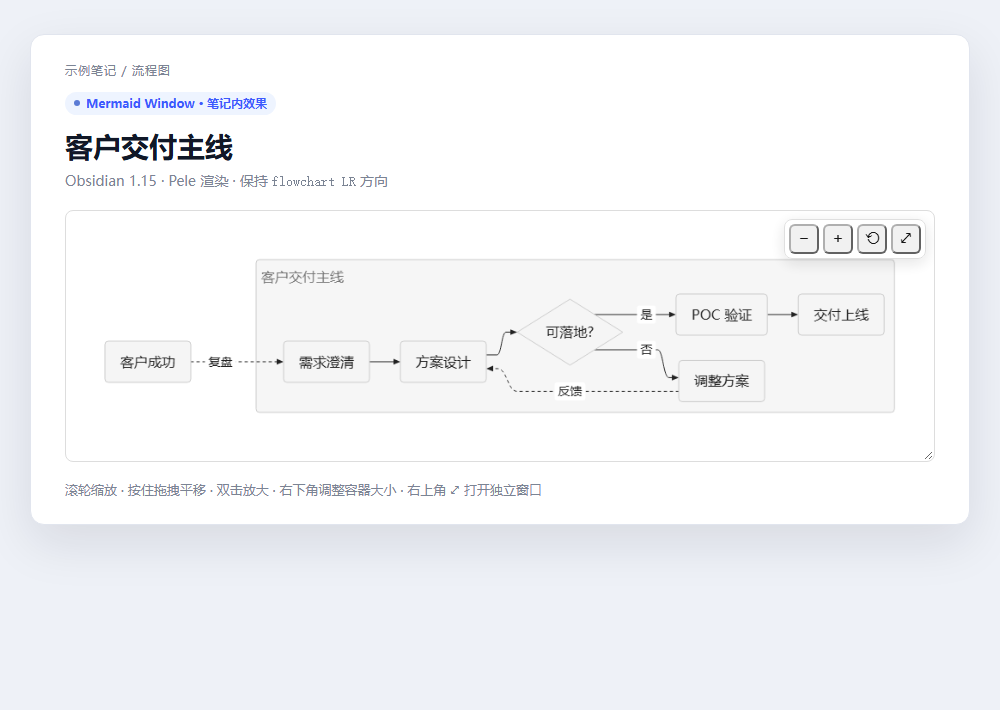
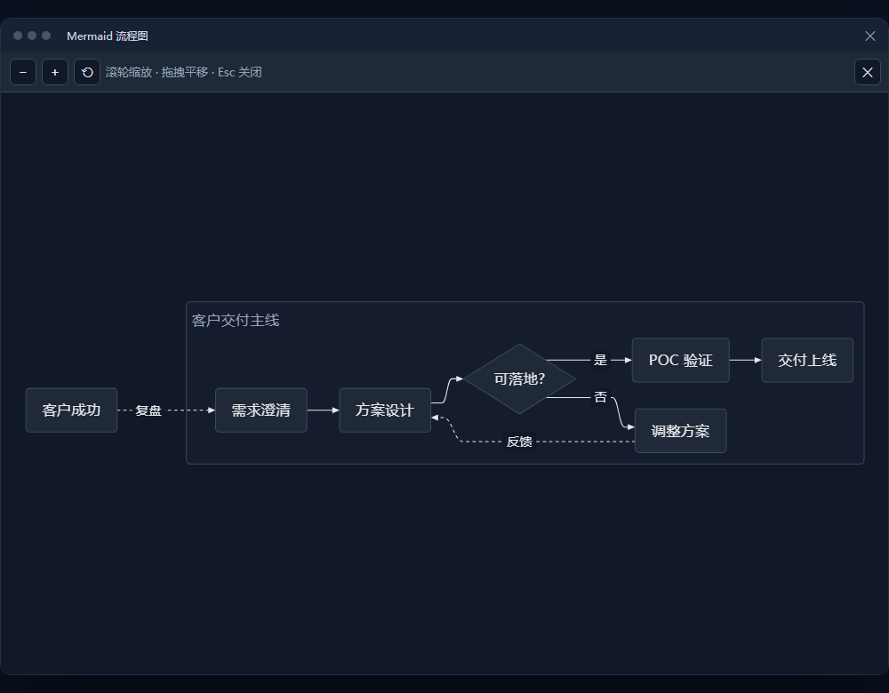
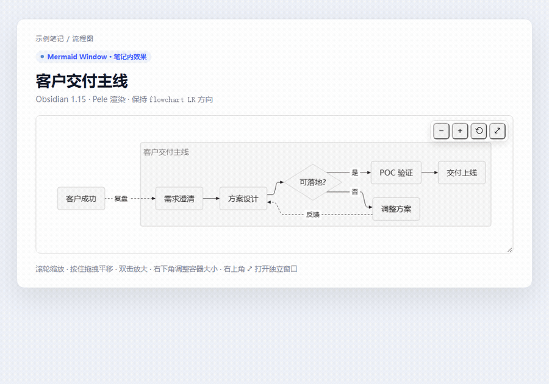
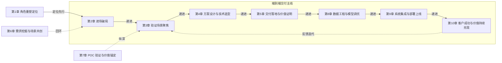
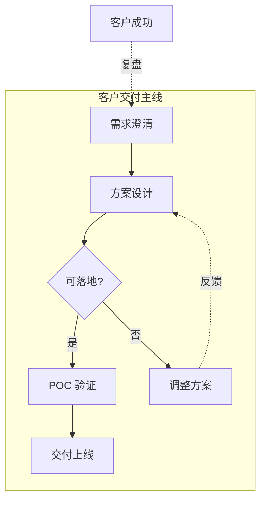
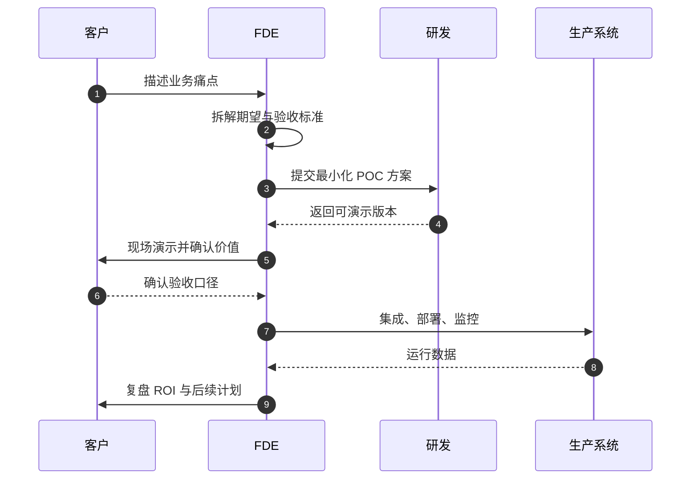
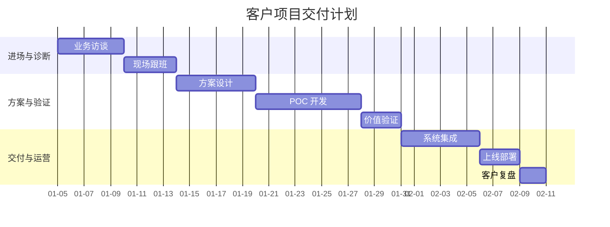

# Mermaid Window —— Obsidian 插件

让 Markdown 里的 **Mermaid 图**支持缩放、平移、拖拽调整容器大小，并可**一键在独立窗口打开**（窗口可拖到任意显示器）。

> 已适配 **Obsidian 1.15+ 的 Pele 渲染器**：保持主题配色、保持代码中写的流程图方向，并关闭 Pele 自带缩放，避免和插件缩放叠加。

## 效果预览

### 笔记内



- 宽流程图保持 `flowchart LR` 横向布局，不会因为笔记区域变窄就自动改成纵向；
- 图太宽时会先整体缩小，使用滚轮或工具栏 `+` 放大即可；
- 右上角工具栏：`−` / `+` / `⟲` / `⤢`；
- 右下角可以拖拽调整容器大小。

### 独立窗口（深色主题）



- 独立系统窗口，可拖到其他显示器；
- 自动继承 Obsidian 当前主题的节点、连线、文字颜色；
- 滚轮缩放、拖拽平移、`Esc` 或右上角 `✕` 关闭。

### 拖动 / 缩放效果



> 动图使用插件真实 DOM/CSS 与 Pele 渲染结果制作，用于展示交互方式；实际界面以你安装后的 Obsidian 为准。

## 功能特性

- **笔记内**
  - 滚轮以鼠标位置为中心缩放
  - 按住左键拖拽平移
  - `Shift` + 滚轮 / 触控板横向滚动左右平移
  - 双击放大
  - 拖动容器右下角调整大小
  - 悬浮/聚焦时显示工具栏
- **独立窗口**
  - 真正的系统窗口，可拖到任意显示器
  - 内部滚轮缩放、拖拽平移
  - `Esc` 或右上角 `✕` 关闭
- **主题绑定**
  - 节点、连线、文字、子图、边标签颜色跟随 Obsidian 主题
  - 深色/浅色主题下独立窗口都与笔记内一致
- **Obsidian 1.15+ 适配**
  - 包装 `.mermaid` 宿主而不是拆出 SVG，Pele 重绘、链接处理、主题变量继续生效
  - 保留 `flowchart LR/RL` 等代码方向
  - 关闭 Pele 自带缩放控件，避免和插件工具栏重叠、双重缩放
  - 兼容 Live Preview 中 `.mermaid` 节点被复用/移动的情况

## 操作说明

| 操作 | 笔记内 | 独立窗口 |
| --- | --- | --- |
| 滚轮 | 以鼠标为中心缩放 | 以鼠标为中心缩放 |
| 按住左键拖拽 | 平移画布 | 平移画布 |
| `Shift` + 滚轮 / 横向滚轮 | 左右平移 | 左右平移 |
| 双击 | 放大 | 放大 |
| 右下角拖拽 | 调整容器大小 | 由系统窗口边框调整 |
| 工具栏 `−` / `+` | 缩小 / 放大 | 缩小 / 放大 |
| 工具栏 `⟲` | 重置并自适应 | 重置并适应窗口 |
| 工具栏 `⤢` | 打开独立窗口 | — |
| `Esc` | — | 关闭窗口 |
| 右上角 `✕` | — | 关闭窗口 |

## 安装

### 方式一：手动安装

1. 将 `mermaid-window` 文件夹整个复制到你的库：`<你的库>/.obsidian/plugins/`
2. 重启 Obsidian（或在“设置 → 第三方插件”中重新加载）
3. 设置 → 第三方插件 → 启用 **Mermaid Window**
4. 若已安装 **Mermaid Flow Zoom**，请停用/卸载，避免同一张图被重复增强

### 方式二：压缩包安装

下载 [mermaid-window-1.0.1.zip](mermaid-window-1.0.1.zip)，解压后把 `mermaid-window` 文件夹放到：

```text
<你的库>/.obsidian/plugins/mermaid-window/
```

### 方式三：AI Agent 一键安装

见同目录《一键安装提示词.md》，把该提示词投喂给任意 AI Agent 自动完成。

## 示例图集

完整可复制示例见：[examples/示例笔记.md](examples/示例笔记.md)

> 下面代码块中的图由 GitHub 的 Mermaid 渲染；GitHub 与 Obsidian/Pele 的配色、节点间距会不同，实际效果以 Obsidian 为准。

### 1. 横向流程图（宽图）

**预期**：保持 `LR` 方向，整体先缩小适配；拖拽平移查看右侧节点，滚轮放大看细节。



### 2. 纵向流程图（含判断与子图）

**预期**：保持 `TD` 纵向布局；子图、虚线、粗箭头、菱形判断都保持原配色；拖拽时整体移动。



### 3. 时序图

**预期**：默认按宽度适配；横向拖拽查看后半段消息，纵向内容多时可在容器内上下拖拽。



### 4. 甘特图

**预期**：时间轴较宽时用横向滚轮或拖拽查看后续任务；滚轮缩放查看日期细节。



更多示例（状态图、类图、ER 图、思维导图）见 [examples/示例笔记.md](examples/示例笔记.md)。

## 不同图表的默认行为

| 图表类型 | 默认布局 | 插件行为 |
| --- | --- | --- |
| `flowchart LR/RL` | 横向 | 保留横向；宽图先缩小，拖拽/滚轮查看 |
| `flowchart TD/TB` | 纵向 | 保留纵向；容器高度自动适应，可上下拖拽 |
| `sequenceDiagram` | 时序 | 按宽度适配，横向拖拽查看后半段 |
| `stateDiagram-v2` | 状态 | 整体自适应，缩放/拖拽 |
| `classDiagram` | 类图 | 整体自适应，适合独立窗口放大 |
| `erDiagram` | ER 图 | 整体自适应，缩放/拖拽 |
| `gantt` / `timeline` | 时间线 | 宽图横向拖拽/缩放 |
| `mindmap` | 思维导图 | 大画布缩放/拖拽 |

## 兼容性与注意事项

- 仅桌面端可用（`isDesktopOnly: true`，依赖 Electron `remote`）。
- **Obsidian 1.15+** 使用 Pele 渲染 Mermaid：
  - Pele 忽略 Mermaid 的 `theme` / `themeVariables` 主题配置；颜色由 Obsidian 主题和 `--mermaid-*` CSS 变量决定。
  - `classDef`、`style` 等节点级样式仍然有效。
  - 本插件主动关闭 Pele 自带缩放，统一使用插件工具栏；这样不会出现两套缩放按钮和双重缩放。
- 非常宽的图默认会被缩小到容器宽度；这是为了先展示全图，使用滚轮或 `+` 放大即可。
- 如果流程图方向仍然变成纵向，请检查源码是否写的是 `flowchart TD` / `TB`，或主题是否给 `.mermaid` 设置了过大的左右内边距。
- 若独立窗口提示“无法创建独立窗口”，请确认使用的是桌面端 Obsidian，且 Electron `remote` 未被禁用。

## 常见问题

**Q：为什么图打开后很小？**
A：宽图默认先完整适配容器宽度。用滚轮或工具栏 `+` 放大，再拖拽查看。

**Q：为什么深色主题下节点/连线颜色和之前不一样？**
A：Obsidian 1.15 的 Pele 使用主题变量决定颜色，不再使用 Mermaid 自带主题。插件会把当前主题变量同步到独立窗口；如果使用自定义主题，可在 CSS 片段中调整 `--mermaid-*` 变量。

**Q：为什么没有出现工具栏？**
A：确认插件已启用、代码块语言是 `mermaid`，然后重启 Obsidian 或重新启用插件。如果安装了 **Mermaid Flow Zoom**，请先停用它。

**Q：升级/卸载后想恢复原状？**
A：停用插件即可；插件会把 `.mermaid` 节点和样式还原。首次安装前的文件可在备份目录中找回。

## 目录结构

```text
mermaid-window/
├── main.js         # 插件主逻辑
├── manifest.json   # 插件清单
└── styles.css      # 插件样式

docs/               # 效果图 / 动图
examples/           # 可直接复制的示例笔记
README.md
一键安装提示词.md
mermaid-window-1.0.1.zip
```

## 版本记录

- **1.0.1**：适配 Obsidian 1.15+ Pele；修复独立窗口配色、流程图方向被自动改为纵向、Pele 自带缩放与插件缩放冲突；增加示例图集与效果图。
- **1.0.0**：首个版本。

## 致谢与许可

- 基于 MIT 协议的开源项目 [Mermaid Flow Zoom](https://github.com/change-wyc/mermaid-flow-zoom) 修改。
- 本项目使用 MIT License，详见 [LICENSE](LICENSE)。
