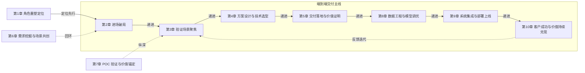
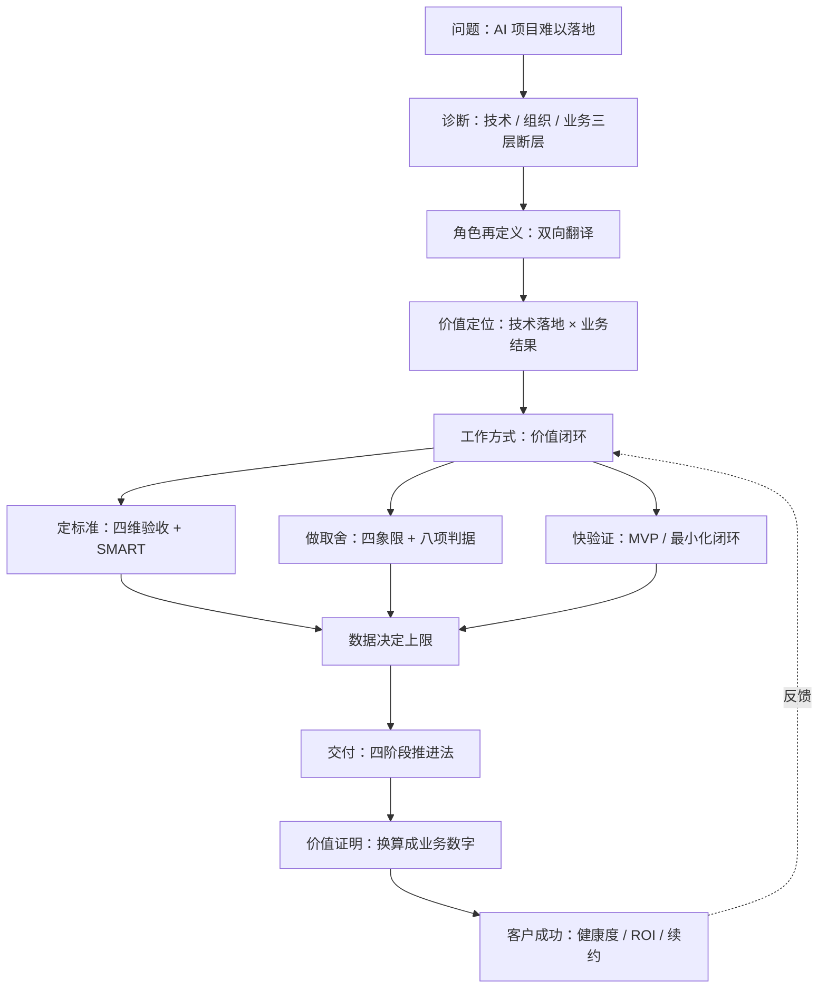
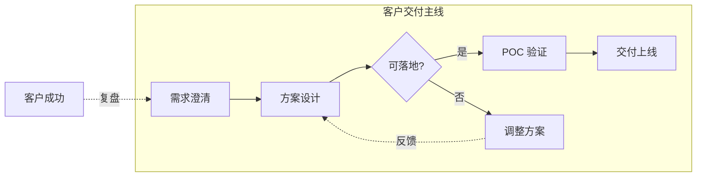
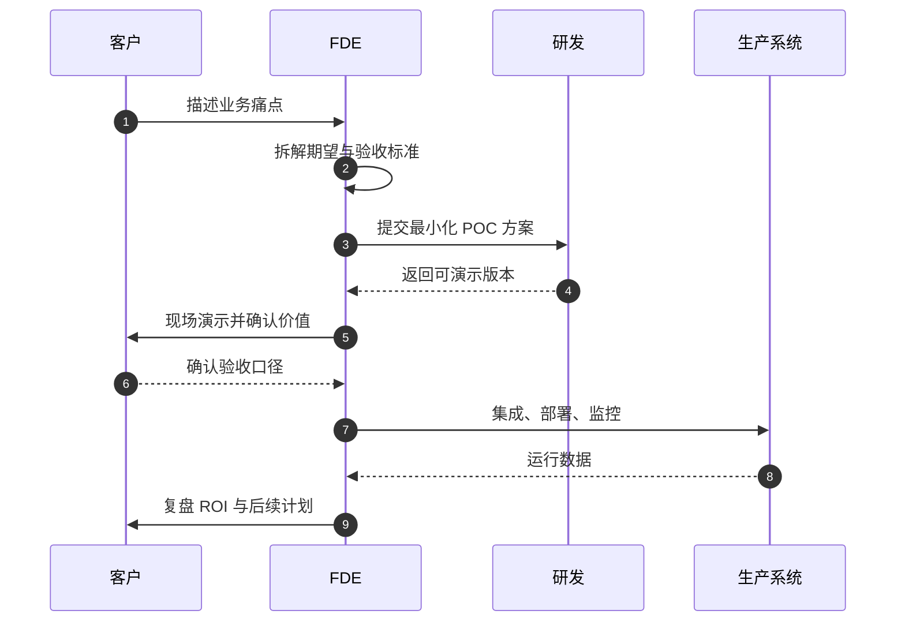
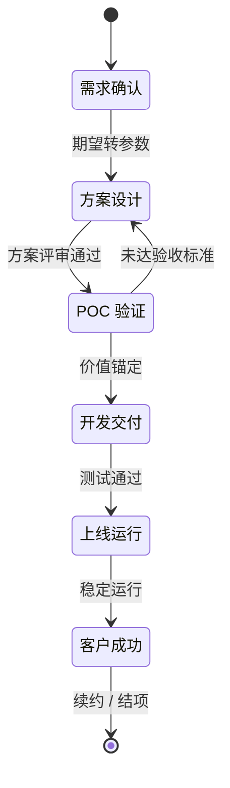
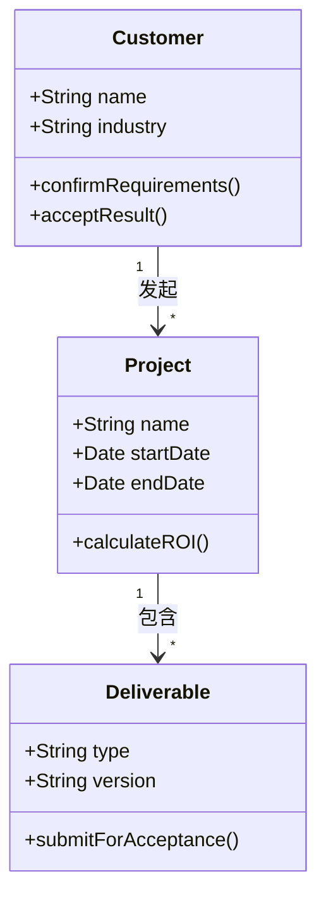
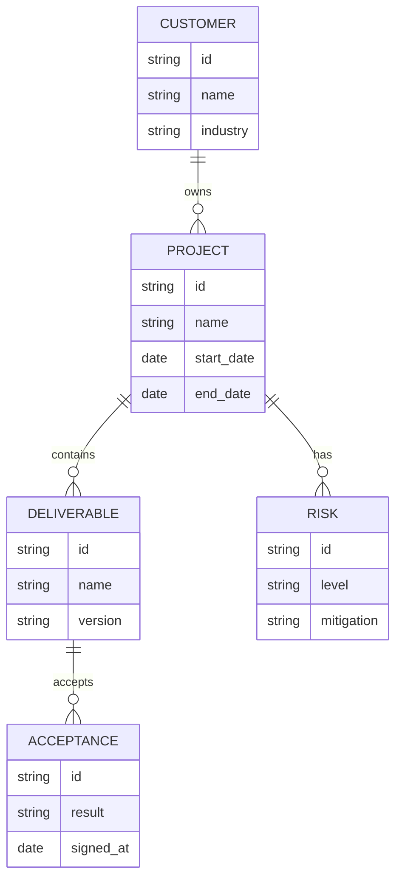
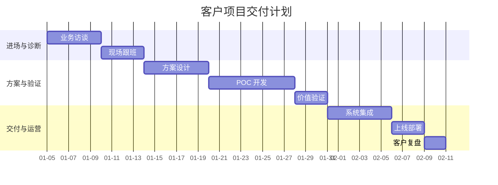
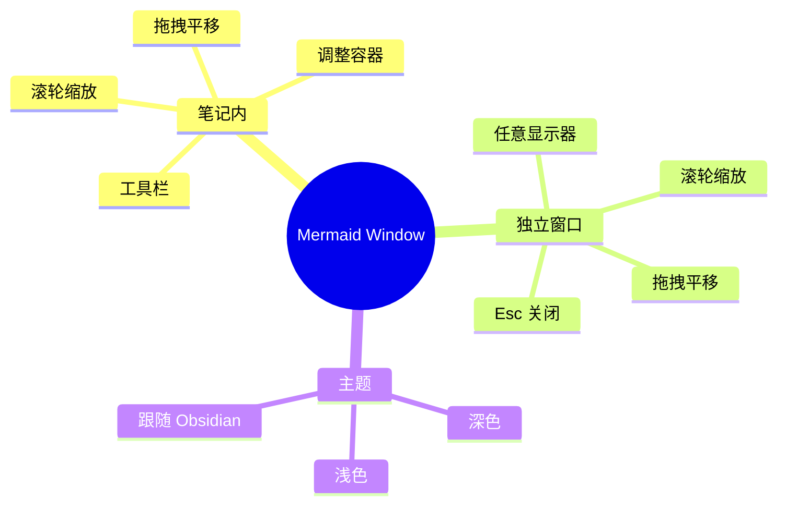

# Mermaid Window 示例笔记

把本文件复制到 Obsidian 库中打开，即可体验插件对不同 Mermaid 图的处理效果。

> 说明：每个代码块渲染后，右上角会出现插件工具栏。
>
> - 滚轮：以鼠标位置为中心缩放
> - 按住左键拖拽：平移画布
> - `Shift` + 滚轮 / 横向滚轮：左右平移
> - 双击：放大
> - 拖动容器右下角：调整容器大小
> - 工具栏 `⤢`：在独立窗口打开

---

## 1. 横向流程图（宽图，保持 LR 方向）

预期效果：即使笔记区域较窄，也保持 `LR` 横向布局；整体先自适应缩小，可用滚轮放大、拖拽查看右侧节点。

---

## 2. 纵向流程图（TD，适合窄屏阅读）

预期效果：保持 `TD` 纵向布局；容器高度会自动适应，纵向内容较多时可在容器内上下拖拽。

---

## 3. 带子图和分支的流程图

预期效果：子图、虚线、粗箭头、菱形判断都保持原有配色和方向；拖拽时整体一起移动。

---

## 4. 时序图

预期效果：时序图默认按宽度适配，横向拖拽查看后半段消息；纵向内容较多时可在容器内上下拖拽。

---

## 5. 状态图

预期效果：状态节点和转换线保持主题配色，缩放/拖拽与流程图一致。

---

## 6. 类图

预期效果：类框、方法列表、关系线整体缩放；适合在独立窗口中查看大图。

---

## 7. ER 图

预期效果：实体、属性、关系连线按主题配色显示；在独立窗口中可放大查看细节。

---

## 8. 甘特图

预期效果：时间轴内容较宽时，使用横向滚轮或拖拽查看后续任务；滚轮缩放查看日期细节。

---

## 9. 思维导图

预期效果：思维导图通常尺寸较大，适合用滚轮缩放和拖拽浏览；也可以在独立窗口中查看。

---

## 验收提示

- 以上所有图都应显示插件工具栏（`−`、`+`、`⟲`、`⤢`）。
- 切换 Obsidian 浅色/深色主题后，节点、连线、文字颜色应同步变化。
- 点击 `⤢` 打开的独立窗口应与笔记内配色一致。
- 如果某个图没有出现工具栏，请重启 Obsidian 或重新启用插件后再试。
